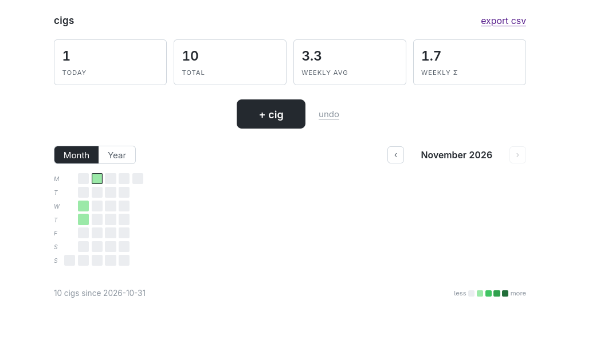
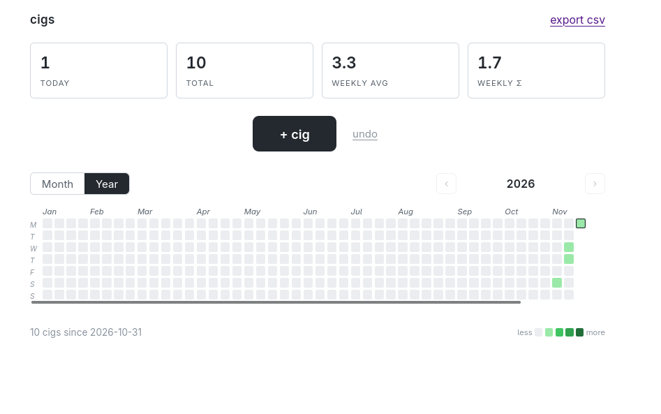

# cigCharts 
Cigcharts is a simple judgment-free way to track smoking habits. I, like many people my age, smoke "socially" but when I try and estimate what "social" looks like I come up
blank. This is a simple self-hostable webpage that tracks your habits with a single button and gives you a GitHub style heatmap along with a csv of the data. 
 
 
If you are the kind of person who kind of smokes, this is kind of for you.
## Examples

 

## Setup Guide

    docker build -t cigCharts .
    docker run -d --name cigCharts --restart unless-stopped -p 5023:8080 -v $PWD/data:/data cigCharts

Open http://localhost:5023

### Data

All data lives in `data/cigs.json` — mount it as `/data` in Docker to persist it.

## Notice
I know next to nothing about cybersecurity and I would not put this anywhere publicly accessible. I do not foresee anything breaking or any risks, but this sits on my home-lab and I access it via VPN. It is designed with that environment in mind. 
